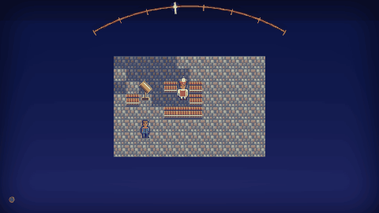

# Sunshift

Sunshift is a 2D puzzle game about guiding the last hour of daylight through four coastal districts. Play as Milo and shift the sun, turn mirrors, and move awnings to give each neighbour the light or shade they need.

Made for [GitHub Game Off 2026](https://itch.io/jam/game-off-2026), whose theme is **SHIFT**.

## Requirements

`project.godot` targets Godot 4.7 with the Compatibility renderer. The project is tested on Godot 4.7.2 stable. [Godot 4.7.2 downloads](https://godotengine.org/download/archive/4.7.2-stable/)

Contributing binary assets requires Git LFS.

## Getting Started

1. Run `git clone https://github.com/chiranjeevi-max/Sunshift.git`.
2. In the Godot Project Manager, import `project.godot` from the checkout.
3. Press **F5** to run the game. Press any key or click to enter the promenade.

## Controls

| Action | Keyboard | Gamepad |
| --- | --- | --- |
| Move | WASD or arrow keys | Left stick or D-pad |
| Rotate the sun counterclockwise | Q | Left shoulder or D-pad left |
| Rotate the sun clockwise | E | Right shoulder or D-pad right |
| Interact | Space or F | Bottom face button |
| Undo | Z or Backspace | Right face button |
| Reset courtyard | R | Top face button |
| Open the Shift Journal | J | Back / Select |
| Pause and accessibility | Esc | Start / Menu |

D-pad left and right are bound to both movement and sun rotation.

## Architecture

- `src/core/` contains the grid, deterministic light solver, level validation, and undo history.
- `src/world/` builds the promenade and courtyards. `src/ui/` owns the title screen, HUD, journal, and pause menu.
- `src/art/`, `src/audio/`, and `src/shaders/` generate and render the sprites, tiles, score, and sound effects.
- `data/` holds 28 courtyard layouts, district palettes, and postcard text.
- `tests/` and `tools/` contain the headless checks, art previews, and level authoring commands.

| Autoload | Role |
| --- | --- |
| `EventBus` | Signals shared by gameplay, UI, and audio |
| `GameState` | Active level, simulation state, undo, and progression |
| `PaletteDirector` | District palettes and gradual warmth changes |
| `SaveManager` | Progress, audio settings, and accessibility preferences |
| `AudioSynth` | Procedural sound effects and adaptive music |

## Web export

Install the Godot 4.7.2 stable export templates and add a Web preset. Turn off Thread Support and export to `index.html`. Keep the generated files together when serving the build or zipping it for itch.io.

## Verification

CI runs `./verify.sh` to compile scripts, run tests and scene smoke checks, and prove the courtyards solvable. Use a disposable Godot `user://` profile for local verification because the scene checks write save data.

## Development Note

Development included AI assistance.

## License

Sunshift's source code is MIT-licensed. Sunshift art, audio, and narrative assets are All Rights Reserved. See [LICENSE](LICENSE) and [CREDITS.md](CREDITS.md).
